# CTS DPS — upload to covenant result, end to end

*For the architect walkthrough · 18 Nov 2026 · repo `vishwasshinde016-tech/cts-dps` (private; moved from `Vishwas2311/cts-dps` on 18 Nov 2026), local copy `C:\Users\vishw\OneDrive\Desktop\Covanent\DPS`*

All paths below are relative to that repo root. Python code is under `dps/src/dps/`.

> **Branch note.** Everything here is on `main`. The covenant taxonomy items (taxonomy codes, the four focused covenant parts, events of default and taxonomy defaults) were merged on 18 Nov 2026.

---

## 1. In one paragraph

1. Spring (Java) uploads the file to the DMS and calls the DPS job API. The DPS saves a **job** in a queue table and answers at once (202).
2. A **Python worker** polls the queue and claims one job. It reads the file from the DMS and checks the file's hash and safety. A sandboxed parser turns PDF, Excel, Word, CSV or image pages into one **page model**, with OCR for scanned pages.
3. The worker then runs a **CrewAI Flow** for that job, isolated per job.
4. In the flow, **rules** (Python regex) read the covenants first. A **page finder** then picks the covenant pages, and **one Document Agent** (CrewAI `Agent`, Azure OpenAI) reads them. Each job gets only its own **skill pack** (prompt, answer schema, limits) and a small **tool set** (page tools plus the Java business rules, wrapped as Python tools).
5. Every AI answer must quote the page it read, or it is dropped (**grounding**).
6. Rules and AI then **vote** per covenant. **Spring tools** check the formulas against the covenant library.
7. A **scorer** gives each field a confidence and routes it to auto-accept or human review. A **coverage check** lists any duty sentence that no field explains.
8. The result (`dps.result/1.0` JSON) is saved, and an **event** tells Spring it is ready.

---

## 2. The diagram

```mermaid
flowchart TB
  subgraph JAVA["Bank side (Java · same VM)"]
    UP["RM uploads document<br/>CTS Spring app"] --> DMS[("DMS<br/>file store")]
    UP --> SUB["POST /dps/v1/jobs<br/>(service token, Idempotency-Key)"]
    LIB["Spring business rules<br/>covenant library · formula check · identifier lookup<br/>contracts/spring-tools.yaml"]
  end

  subgraph API["DPS API (FastAPI) — jobapi.py"]
    SUB --> VAL["validate request, de-duplicate,<br/>tenant queue limit"]
    VAL --> Q[("dps_job queue table<br/>jobs.py")]
  end

  subgraph WORKER["Python worker — worker.py  (python -m dps.worker)"]
    Q -->|"poll + claim (compare-and-set, lease)"| CLAIM["claim one job"]
    CLAIM --> ING["Ingest — ingest/pipeline.py<br/>read from DMS + SHA-256 check"]
    ING --> INS["Inspect — ingest/inspect.py<br/>type spoof · encrypted · macros · size<br/>(pikepdf, oletools)"]
    INS --> SBX["Parse in sandbox — parse/sandbox.py<br/>child process, CPU/RAM/time limits, no network"]
    SBX --> PM["Page model dps.page-model/1.0 — parse/page_model.py<br/>PDF: pypdf text → RapidOCR if no text → Docling (heavy pool)<br/>pdfplumber boxes/tables · Excel: openpyxl/xlrd · Word: python-docx"]
    PM --> ROUTE{"job type?"}
  end

  ROUTE -->|"EXTRACT_AGREEMENT"| FA
  ROUTE -->|"ONBOARD · EXTRACT_SANCTION ·<br/>EXTRACT_AMENDMENT · EXTRACT_CERTIFICATE"| FS

  subgraph FLOWS["CrewAI Flow per job (isolated state)"]
    FA["Agreement Intake Flow — flows/intake.py<br/>parse → extract → normalize → validate → publish / hold"]
    FS["Skill Job Flow — flows/skill_job.py<br/>run_skills → save_result"]
    FS --> CLS["Classify — analyze/classify.py<br/>rules first, small model only if unsure"]
    CLS --> PACK["pick skill pack — skills/runner.py<br/>LOAN_AGREEMENT→covenants · SANCTION→sanction · AMENDMENT→amendment_diff"]
  end

  FA --> EXT
  PACK --> EXT

  subgraph EXTRACT["Covenant extraction — skills/runner.py · _extract()"]
    EXT["1 · Rules (no AI)<br/>skills/covenants/rules.py → extraction/agreement.py<br/>+ safety net extraction/coverage.py"]
    EXT --> PAGES["2 · Page finder<br/>skills/covenants/pages.py<br/>rule hits → covenant sections → duty sentences → definitions<br/>up to 4 batches × 25 pages"]
    PAGES --> PARTS["3 · Focused parts<br/>skills/covenants/parts.py<br/>financial · undertakings · reporting · events of default"]
    PARTS --> AGENT
    subgraph AG["Document Agent — agent/document_agent.py"]
      AGENT["ONE CrewAI Agent per read<br/>no memory, no delegation<br/>skill = pack.yaml + prompt.md + schema.json"]
      TOOLS["Tools (CrewAI BaseTool)<br/>page_text · search_text · find_definition<br/>covenant_library · validate_formula · lookup_identifier"]
      AGENT <--> TOOLS
    end
    AGENT -->|"every call"| GW["Model gateway — agent/gateway.py<br/>Azure OpenAI routes small/strong/vision<br/>retries · circuit breaker · token budget · JSON schema check · masking"]
    TOOLS -.->|"batched HTTP"| LIB
    AGENT --> GRD["4 · Grounding — skills/common.py grounded()<br/>quote must be on the cited page (±1) or dropped"]
    GRD --> NAMES["5 · Names clean — skills/covenants/names.py<br/>library keys / taxonomy codes, drop loan mechanics"]
    NAMES --> VOTE["6 · Vote rules vs AI — runner._vote_covenants()<br/>agree → RULES+AI_CONFIRMED · differ → review · AI-only → review"]
    VOTE --> SPR["7 · Verify with Spring — runner.verify_with_spring()<br/>formula check + covenant library (Java)"]
    SPR --> STAMP["8 · Taxonomy codes<br/>skills/covenants/codes.py stamp()<br/>code · category · defaults → TAXONOMY_DEFAULT"]
    STAMP --> SCORE["9 · Score + route — scoring/__init__.py<br/>HIGH-risk fields → review · MEDIUM ≥0.95 · LOW ≥0.90 · 3% QA sample"]
    SCORE --> COV["10 · Coverage check — skills/covenants/coverage.py<br/>every duty sentence explained by a field, else COVERAGE_GAP"]
  end

  COV --> RES["Result dps.result/1.0<br/>contracts/schemas/result.json<br/>saved in dps_run"]
  RES --> EVT["Event feed — feed.py (dps_event_feed)<br/>GET /dps/v1/events"]
  EVT --> REVIEW["Spring pulls result<br/>GET /dps/v1/jobs/{id}/result<br/>RM confirms in the onboarding grid"]
```

---

## 3. Step by step, with code locations

### Step 1 — Upload and job submit (Spring → DPS API)

| What | Where |
|---|---|
| Job endpoint `POST /dps/v1/jobs` (202, `Idempotency-Key`, de-dup on same file + type + pipeline, queue limit → 429) | `dps/src/dps/jobapi.py` (`submit_job`) |
| Job types → flow (`EXTRACT_AGREEMENT`→`AGREEMENT_INTAKE`, `ONBOARD`→`SKILL_PACK` …) | `dps/src/dps/jobapi.py` (job type table at the top) |
| API contract | `contracts/dps-jobs-api.yaml`, `contracts/schemas/job-request.json`, `job-status.json` |
| Service auth | `dps/src/dps/service_auth.py`, `auth.py` |

### Step 2 — Queue and worker (the Python worker polls)

| What | Where |
|---|---|
| Queue table `dps_job`. Claim is a conditional UPDATE (compare-and-set), so it is safe with many workers. It has priorities, a lease, retry wait and a DEAD state for poison files. | `dps/src/dps/jobs.py`, `dps/src/dps/models.py` |
| Worker loop: claim one job, ingest, run its flow, retry transient errors. `DPS_WORKER_POOL=HEAVY` switches to the Docling pool. | `dps/src/dps/worker.py` |

### Step 3 — Ingest, inspect, parse (file → page model)

| What | Library | Where |
|---|---|---|
| Read from DMS, SHA-256 check (`INTEGRITY_MISMATCH`), reuse a page model already built for the same bytes | – | `dps/src/dps/ingest/pipeline.py`, `ingest/store.py` |
| Inspection: `TYPE_SPOOFED`, `CORRUPT`, `ENCRYPTED`, `MACRO_PRESENT`, `TOO_LARGE`, `TOO_MANY_PAGES` | **pikepdf**, **oletools** | `dps/src/dps/ingest/inspect.py` |
| Sandbox: child process with RAM/CPU limits and no network; time limit 60 s per 10 pages, max 15 min | – | `dps/src/dps/parse/sandbox.py`, `parse/server.py` |
| PDF text: native text first | **pypdf** | `dps/src/dps/parsing.py` (`ParserEngine`) |
| Scanned pages (no text layer) → OCR | **RapidOCR** (onnxruntime), page images by **pypdfium2** | `dps/src/dps/parsing.py` (`RapidOcrBackend`) |
| Bad layout → heavy fallback (opt-in pool) | **Docling** | `dps/src/dps/parsing.py` (`HeavyEngine`, `DoclingConverter`) |
| Line boxes + tables for citations | **pdfplumber** | `dps/src/dps/parse/page_model.py` |
| Excel `.xlsx` / `.xls`, CSV | **openpyxl**, **xlrd** | `parse/page_model.py` (`build_xlsx`, `build_xls`, `build_csv`) |
| Word `.docx` | **python-docx** | `parse/page_model.py` (`build_docx`) |
| Split bundled PDFs (schedule, annexure, certificate …) | rules | `dps/src/dps/parse/segment.py` |
| Page model schema | – | `contracts/schemas/page-model.json` |

Not used: Azure AI Document Intelligence. Parsing and OCR run locally.

### Step 4 — CrewAI Flow per job

| Flow | Used for | Where |
|---|---|---|
| **Agreement Intake Flow**: `parse → extract → normalize → validate → publish / hold / heavy`. Its state is saved, so a job held for review resumes. | `EXTRACT_AGREEMENT` | `dps/src/dps/flows/intake.py` |
| **Skill Job Flow**: `run_skills → save_result` | `ONBOARD`, `EXTRACT_SANCTION`, `EXTRACT_AMENDMENT`, `EXTRACT_CERTIFICATE`, `ANALYZE` | `dps/src/dps/flows/skill_job.py` |
| Statement flow | `EXTRACT_STATEMENT` | `dps/src/dps/flows/statement.py` |
| Flow state persistence (`dps_flow_state`) | resume after review | `dps/src/dps/flows/persistence.py` |

For `ONBOARD`, the document is first **classified** (`analyze/classify.py`). Rules decide when they are sure: top score ≥ 0.8 and a lead of ≥ 0.3. Otherwise the small model decides, with quotes. The class then picks the skill pack (`skills/runner.py` `ONBOARD_PACKS`).

### Step 5 — The Agent and its skills (one agent, many skills)

**One agent.** `agent/document_agent.py`, `make_agent()` / `read()`:
- A fresh CrewAI `Agent` is built for every read, with no memory and no delegation. Nothing from one job reaches another.
- `max_turns` and tool-call limits come from the pack.

**Skills = skill packs.** Each pack is a folder `dps/src/dps/skills/<name>/` with:
- `pack.yaml`: version, job types, model route, tools, page selection, limits, field risk, thresholds;
- `prompt.md`: the instructions;
- `schema.json`: the JSON answer the agent must return;
- `rules.py`: proposals found without AI.

A pack changes only through a PR plus the golden-set gate.

| Skill pack | Job type | Tools it may use | Path |
|---|---|---|---|
| **covenants** (v3.0.0) | EXTRACT_AGREEMENT, ONBOARD (agreement) | page_text, search_text, find_definition, covenant_library, validate_formula | `skills/covenants/` |
| sanction | EXTRACT_SANCTION | same 5 | `skills/sanction/` |
| amendment_diff | EXTRACT_AMENDMENT | same 5 | `skills/amendment_diff/` |
| certificate | EXTRACT_CERTIFICATE | page_text, search_text, lookup_identifier | `skills/certificate/` |
| schedule_terms | called inside covenants and sanction (drawdown, repayment, fees) | page_text, search_text, find_definition | `skills/schedule_terms/` |
| statement_lines | EXTRACT_STATEMENT (second reader) | – | `skills/statement_lines/` |
| commentary | DRAFT_COMMENTARY | – | `skills/commentary/` |

**Tools** (CrewAI `BaseTool` classes in `agent/document_agent.py`):

| Tool | Does | Backed by |
|---|---|---|
| `page_text` | open any page of this job's document | page model |
| `search_text` | search the whole document | page model |
| `find_definition` | find "EBITDA means …" etc. | page model |
| `covenant_library` | the bank's covenant library | **Java (Spring)** via `spring_tools.py` |
| `validate_formula` | check a covenant formula is valid | **Java (Spring)** via `spring_tools.py` |
| `lookup_identifier` | match CP / obligor / facility IDs | **Java (Spring)** via `spring_tools.py` |

**Java business rules as Python tools.** `dps/src/dps/spring_tools.py` (`SpringTools`), contract `contracts/spring-tools.yaml`:
- **Batched:** one HTTP call per document.
- **Bounded:** timeout, retries and a circuit breaker.
- **Degrading:** if Spring is down, each item comes back `SPRING_UNAVAILABLE`, that field goes to review, and the job continues.

**Model gateway.** `dps/src/dps/agent/gateway.py`, with `GatewayLLM` in `document_agent.py`. Every model call goes through it:
- Azure OpenAI routes `small` / `strong` / `vision`;
- retries 2/8/30 s;
- a circuit breaker → `AI_UNAVAILABLE`;
- a per-job token budget → `AI_BUDGET_EXCEEDED`;
- the answer must match the JSON schema (one repair call, then `MODEL_OUTPUT_INVALID`);
- masking and a call log (`dps_ai_call`, `dps_ai_usage`).

A model problem never fails a job. The job falls back to rules only, and the fields go to review.

### Step 6 — Covenant extraction: rules + AI (the core)

Order of work in `dps/src/dps/skills/runner.py` `_extract()`. The Agreement Intake Flow runs the same reader through `extraction/agreement_ai.py` `read_with_skill()`.

| # | Step | What happens | Where |
|---|---|---|---|
| 1 | **Rules** (no AI) | Numbered-clause scan, metric aliases (DSCR, ICR, Debt/EBITDA, TNW …), threshold phrases ("not less than 1.25x"), non-financial rules. Every term carries its page and a verbatim quote. A **safety net** sends covenant-shaped sentences that no rule explains to a person. | `skills/covenants/rules.py`, `extraction/agreement.py`, `extraction/coverage.py` |
| 2 | **Page finder** | Scores every page without AI, in this order: rule-hit pages, then covenant section headings (+ next page), then duty sentences, then definitions. Up to **4 batches × 25 pages**. Pages left out stay reachable through the tools. | `skills/covenants/pages.py` (`covenant_batches`) |
| 3 | **Focused parts** | The covenants skill runs as 4 focused reads: financial, undertakings (affirmative + negative), reporting, events of default. Each read gets only its part's slice of the taxonomy in the prompt. | `skills/covenants/parts.py`, `skills/covenants/prompt.md` |
| 4 | **Agent read** | The Document Agent reads each batch. The answer must match `schema.json`. | `skills/common.py` (`batched_proposals`, `agent_proposals`) |
| 5 | **Grounding** | The quote must appear on the cited page (or ±1 page, or across the break). Otherwise the item is dropped; salvage retries with neighbour pages. | `skills/common.py` (`grounded`) |
| 6 | **Names clean** | Each item gets a library key / taxonomy code (or OTHER, keeping the name as written). Loan mechanics (drawdown, prepayment, fees) are dropped. One item per clause area. | `skills/covenants/names.py` |
| 7 | **Vote** rules vs AI | Same covenant and same number → `RULES+AI_CONFIRMED` (confidence ↑). Different number → `MODELS_DISAGREE` → review. Found by AI only → `AI_ONLY` → review. Matching is one-to-one, keyed by covenant code. | `skills/runner.py` (`_vote_covenants`, `_agent_only`), `skills/common.py` (`vote`) |
| 8 | **Schedule terms** | Calendar clauses (repayment, fees, drawdown) are read by their own skill, with rules + agent + vote. | `skills/schedule_terms/` |
| 9 | **Scanned pages** | A page OCR can't read goes to the vision route. Every value read from an image goes to a person (`READ_FROM_IMAGE`). | `agent/vision.py` |
| 10 | **Verify with Java** | Formula check and covenant library through Spring tools. | `skills/runner.py` (`verify_with_spring`), `spring_tools.py` |
| 11 | **Taxonomy codes** | Each covenant gets `code` + `category` from the bank's covenant taxonomy (98 types). Missing operator/unit/frequency is filled from the taxonomy, listed in `value.defaults` and flagged `TAXONOMY_DEFAULT`; the field goes to review. Events of default become their own `EVENT_OF_DEFAULT` fields. | `skills/covenants/codes.py`, `skills/covenants/taxonomy/` (`default_taxonomy.yaml` + `dps_overlay.yaml`) |
| 12 | **Score + route** | Confidence comes from signals (grounded, voted, OCR quality, field risk). HIGH-risk fields (threshold, operator) are always reviewed. MEDIUM is auto-accepted at ≥ 0.95, LOW at ≥ 0.90. A 3% QA sample is reviewed. | `scoring/__init__.py`, `pack.yaml` (`field_risk`, `thresholds`) |
| 13 | **Coverage check** | Every duty sentence on the covenant pages must be explained by a field: by quote, or by kind (same covenant family nearby). Otherwise `COVERAGE_GAP` lists the pages. | `skills/covenants/coverage.py` |

**Who decides.** The rules' covenants stay the source. The AI confirms, questions, or adds proposals for a person, and it never applies a covenant by itself. The RM confirms everything in the onboarding grid.

### Step 7 — Output, events, review

| What | Where |
|---|---|
| Result JSON `dps.result/1.0`. It holds: fields (group, name, value, source page + quote, confidence, status, issues); document route; coverage; warnings; pipeline (version, skillPack, taxonomyVersion); usage. | `contracts/schemas/result.json`, built in `skills/runner.py` `run()` / `results.py` |
| Saved run | table `dps_run`, `dps_extracted_term` (`models.py`) |
| Event to Spring (same DB transaction as the change, at least once) | `dps/src/dps/feed.py`, `contracts/catalogues/events.yaml`, `GET /dps/v1/events` |
| Spring pulls the result | `GET /dps/v1/jobs/{id}/result` (`jobapi.py`) |
| Review decisions | `dps/src/dps/review_api.py`, `contracts/schemas/review-decisions.json` |
| Error codes (one catalogue) | `contracts/catalogues/errors.yaml`, `dps/src/dps/errors.py` |

---

## 4. Runtime, logging, exceptions

| Concern | How | Where |
|---|---|---|
| Logs, traces, metrics | spans `dps.ingest`, `dps.skill`, `dps.analyze`; trace events table | `observability.py`, `logcollector.py`, `dps_trace_event` |
| AI cost and usage | per call and per job; monthly budget | `usage.py`, `ai_guard.py`, `dps_ai_usage`, `dps_ai_call` |
| Prompt injection | text that addresses an AI → every proposal held with `PROMPT_INJECTION_SUSPECTED` | `ai_guard.py`, `flows/intake.py` |
| Retries | transient errors (DMS/Spring down) → back to the queue; a crash twice on the same file → DEAD | `worker.py`, `jobs.py` |
| Audit | sealed audit events | `dps_audit_event`, `dps_audit_seal`, `/dps/v1/ops/audit-seals` |
| DB | SQL Server in production, SQLite in tests; Alembic migrations | `models.py`, `dps/migrations/` |

## 5. Libraries at a glance

| Area | Libraries |
|---|---|
| API | FastAPI, uvicorn, pydantic, python-multipart, PyJWT |
| DB | SQLAlchemy 2.0, Alembic, pymssql (SQL Server) |
| Agent / flows | **CrewAI 1.15.34** (`Agent`, `Flow`, `BaseTool`, `BaseLLM`), Azure OpenAI via `azure-ai-inference`, httpx |
| PDF | **pypdf** (text), **pdfplumber** (boxes/tables), **pypdfium2** (page images), **pikepdf** (inspection/repair) |
| OCR | **RapidOCR** (onnxruntime) |
| Heavy layout | **Docling** (heavy pool only) |
| Office | **openpyxl** (.xlsx), **xlrd** (.xls), **python-docx** (.docx), **oletools** (macro checks) |
| Quality | pytest, ruff, bandit; golden set in `golden-set/` (`predict.py`, `evaluate.py`) |

Dependencies are pinned in `dps/pyproject.toml`.

## 6. How we prove it works

| What | Where |
|---|---|
| Unit + e2e tests (≈ 800), incl. a stand-in Spring server | `dps/tests/` (e.g. `test_e2e_stub_spring.py`, `test_recall.py`, `test_covenant_names.py`) |
| Golden set: labelled documents, recall/precision per field, gate on every skill-pack PR | `golden-set/` (`README.md`, `predict.py`, `evaluate.py`, `labels/`) |
| Benchmarks on real agreements | `benchmarks/` |
| Live result on 85-page agreements (Azure) | coverage 26% → 47–51%, covenants 51 → 58–59 (before the taxonomy branch) |
| Design docs | `docs/cts-dps/` |

## 7. Files to open while explaining (in this order)

1. `contracts/dps-jobs-api.yaml`: what Spring calls
2. `dps/src/dps/jobapi.py` → `jobs.py` → `worker.py`: job, queue, worker
3. `dps/src/dps/ingest/pipeline.py` → `ingest/inspect.py` → `parse/sandbox.py` → `parse/page_model.py` → `parsing.py`: file to pages
4. `dps/src/dps/flows/intake.py` and `flows/skill_job.py`: the CrewAI Flows
5. `dps/src/dps/skills/covenants/pack.yaml`, `prompt.md`, `schema.json`, `rules.py`: the covenants skill
6. `dps/src/dps/skills/covenants/pages.py` → `parts.py` → `agent/document_agent.py` → `agent/gateway.py`: page finder, agent, tools, model
7. `dps/src/dps/spring_tools.py` + `contracts/spring-tools.yaml`: Java rules as tools
8. `dps/src/dps/skills/runner.py` `_extract()`: the whole extraction order in one function
9. `dps/src/dps/skills/covenants/codes.py` + `taxonomy/`: taxonomy codes
10. `dps/src/dps/scoring/__init__.py` → `skills/covenants/coverage.py` → `contracts/schemas/result.json`: confidence, coverage, output
